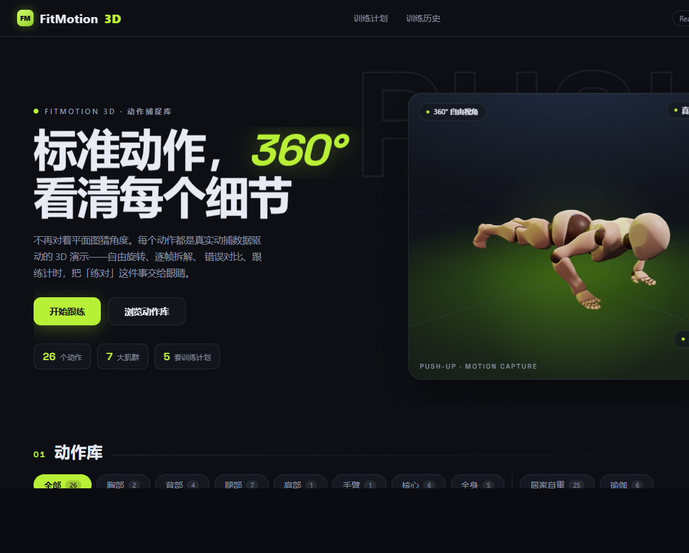

## 项目简介

FitMotion 3D 是一个交互式健身动作库。不再对着平面图猜角度：每个动作都可以 360° 旋转、逐帧拆解，并对照常见错误跟练。口号是「标准动作，360° 看清每个细节。」

地址：https://zchuhui.github.io/fitness-3D/

## 核心能力

- **动作库**：目前 26 个动作，覆盖胸部、背部、腿部、肩部、手臂、核心、全身 7 个肌群，可按部位、居家自重、瑜伽筛选，也能用中文或英文名搜索。
- **3D 查看器**：自由旋转、播放与调速、关键帧跳转，并提供正面、侧面、背面、俯视和自动旋转。视角模式包括教练、透视和力学。
- **动作教学**：每条动作写明目标肌群、器械、难度和建议组数。动作要点可点进对应关键帧。
- **错误对比**：常见错误可与标准示范分屏对照，例如俯卧撑的塌腰、肘部外展和半程动作。
- **跟练计时**：按组数、次数和组间休息带练，节奏可选 0.5×、0.75×、1×，支持音效和语音提示。
- **训练计划**：5 套计划把动作串成整套，包括推力日、拉力日、腿部日、居家全身和核心专攻。
- **训练历史**：跟练记录留在浏览器本地，包含连续天数、12 周热力图和最近记录。

## 技术亮点

- 前端使用 React 与 React Three Fiber，3D 查看器基于 Three.js，同时加载 GLB 与 FBX。
- 动作数据写在 `src/data/exercises.ts`。一部分动作使用动作捕捉，带「生成演示」的动作按标准关节角度生成，也可以换成 Mixamo 的 FBX 放进 `public/models/`。
- 训练日志只存在本地浏览器，页面带 Service Worker 注册，适合作为可安装的纯前端应用。

## 收录现状

截至 2026 年 10 月，动作库收录 26 个动作、7 大肌群、5 套训练计划。居家自重 25 个，瑜伽相关 6 个。
