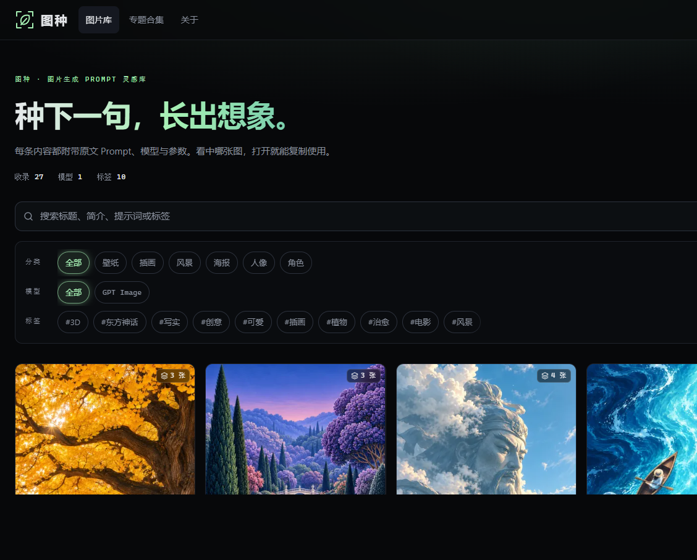

## 项目简介

图种，读作「图 zhǒng」。每一条提示词都是一颗能长出画面的种子：先看效果图，再把原文 Prompt 复制到自己的生成工具里使用。口号是「种下一句，长出想象。」

地址：https://prompt.dolfi.chat

## 核心能力

- **按画面找写法**：图片库以效果图为主，分类覆盖壁纸、插画、风景、海报、人像、角色。看中哪张图，打开就能复制使用。
- **原文即用**：详情页按录入时的原文展示 Prompt，保留换行；一键复制，不会在复制时改写。
- **规格可见**：每条内容标明模型、分类、来源（原创或收集）和发布日期，并给出提示词字数。收集内容尽量保留作者和来源链接；需要参考图的内容会单独标出。
- **检索与筛选**：可搜索标题、简介、提示词和标签，并按分类、模型、标签过滤。
- **专题合集**：把同一方向的提示词收成一组，例如「东方幻想治愈壁纸」「治愈系哲理海报」，适合从一个主题集中找灵感。
- **多图浏览**：一条内容可以挂多张效果图，支持切换、放大和相关推荐。
- **开放浏览**：访客无需注册。草稿、已撤回和已删除的内容不会出现在公开页面、搜索或站点地图里。
- **分享与 SEO**：详情页可直接分享，并带有独立标题、描述、Canonical 与 Open Graph 图片。

## 技术亮点

- 前端使用 Next.js 与 Tailwind CSS，深色主题。卡片图、详情图和原图通过 `/api/v1/media` 提供。
- 公开页与内容状态分离：未发布内容不进入列表、搜索和站点地图。
- 页面明确说明生成效果会随模型版本、参数和随机性变化，同一次出图只作为参考。

## 收录现状

截至 2026 年 11 月 3 日，图片库收录 27 条，当前模型为 GPT Image，标签 10 个，专题合集 2 组。
